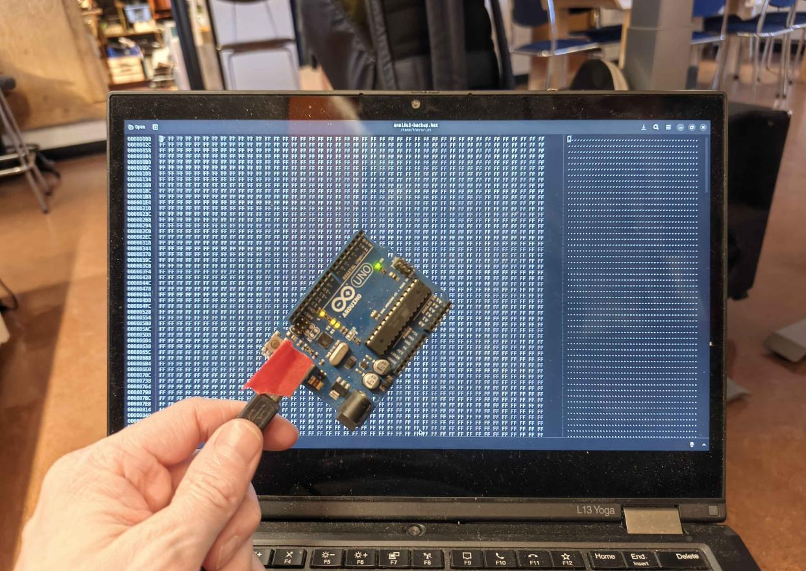
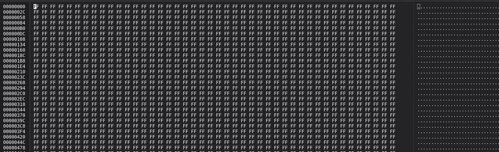
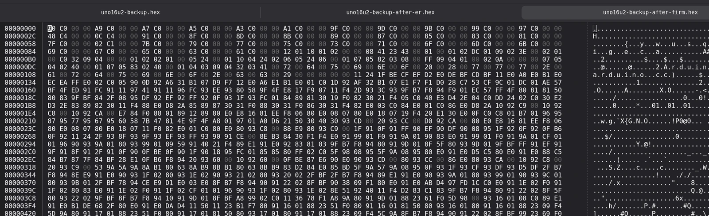
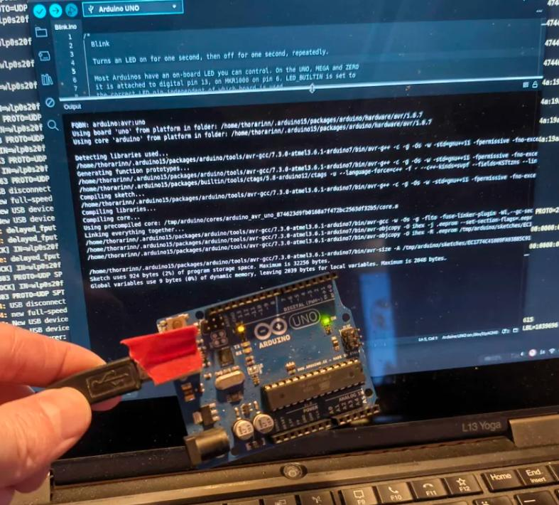

# Reviving a Bricked Arduino Uno R3

Recently, while cleaning up the lab, we found an old Arduino Uno R3 with a through-hole ATmega328P chip. It had a red sticker on it with no label, so we put it aside, suspecting there might be something wrong with it.



The following day, I decided to take a closer look. I found a USB cable, connected the board to my laptop, and ran `dmesg -w` to see what was going on.

The Arduino was detected, but it didn't show up as a serial device. At first, I thought the ATmega328P might be damaged and need replacing. However, I had a faint memory of trying to revive this same Arduino years ago without much success.

Since then, I've learned a thing or two about microcontrollers, so I decided to investigate a little further before giving up on it.

## Investigating the Problem

Looking more closely at the USB messages, I found that the board was identifying itself with the USB ID `03eb:2fef`.

```
[23256.627956] usb 3-4: new full-speed USB device number 19 using xhci_hcd
[23256.756471] usb 3-4: New USB device found, idVendor=03eb, idProduct=2fef, bcdDevice= 0.00
[23256.756483] usb 3-4: New USB device strings: Mfr=0, Product=1, SerialNumber=0
```

This turned out to be the ATmega16U2 USB interface running in DFU (Device Firmware Upgrade) mode, rather than its normal USB-to-serial mode.

While looking into recovering bricked Arduinos, I came across a tool called [**dfu-programmer**](https://github.com/dfu-programmer/dfu-programmer), which can read, erase, and program the flash memory of certain AVR microcontrollers over USB.

I installed it and checked whether I could communicate with the ATmega16U2. It worked, so I decided to make a memory dump using:

```
sudo dfu-programmer atmega16u2 dump > uno16u2-backup.hex
```

Curious to see what was in the file, I opened it in a hex editor. To my surprise, the memory appeared to contain nothing but `FF` bytes, which is normally what erased flash memory looks like.



I had given the file a `.hex` extension, although `dfu-programmer dump` actually produces raw binary data. This wasn't a problem for the hex editor.

## Restoring the Firmware

I tried erasing the chip and made another dump. It still contained only `FF` bytes, as expected.

The next step was to restore the original firmware. Luckily, I already had the Arduino AVR board package installed, and the correct firmware file, `Arduino-usbserial-atmega16u2-Uno-Rev3.hex`, was included with it.

I used the following commands to erase and flash the ATmega16U2:

```
sudo dfu-programmer atmega16u2 erase

sudo dfu-programmer atmega16u2 flash \
  ~/.arduino15/packages/arduino/hardware/avr/1.8.7/firmwares/atmegaxxu2/arduino-usbserial/Arduino-usbserial-atmega16u2-Uno-Rev3.hex
```

After flashing, I made another memory dump.

This time things looked very different. Instead of a long list of `FF` bytes, I could see actual program data in the hex editor. It was interesting to see the difference before and after flashing.



Next, I ran:

```
sudo dfu-programmer atmega16u2 reset
```

I tried making one final dump, but this time the file was completely empty. At first, that seemed strange, but the explanation was simple. The ATmega16U2 had exited DFU mode and was now running its restored firmware, so `dfu-programmer` could no longer communicate with it in the same way.

## Back to Life

Looking back at the `dmesg` window, I could see that something had changed:

```
[23918.822708] usb 3-4: new full-speed USB device number 20 using xhci_hcd
[23918.955901] usb 3-4: New USB device found, idVendor=2341, idProduct=0043, bcdDevice= 0.01
[23918.955918] usb 3-4: New USB device strings: Mfr=1, Product=2, SerialNumber=220
[23918.955931] usb 3-4: Manufacturer: Arduino (www.arduino.cc)
[23918.960852] cdc_acm 3-4:1.0: ttyACM0: USB ACM device
```

The Arduino was now identifying itself as `2341:0043`, and Linux had created a serial port at `/dev/ttyACM0`. The LEDs on the board were also behaving differently.

Things were looking promising, but I didn't want to declare it fixed before testing the ATmega328P itself.

I launched the Arduino IDE, opened the Blink example, selected the Uno and its serial port, and uploaded the sketch.



**It worked flawlessly!**

After that, I removed the red sticker, and now we have one more working Arduino Uno in the lab.

What I initially thought might require replacing a microcontroller turned out to be a firmware problem that could be fixed entirely through software.

Discovering `dfu-programmer` was probably the most interesting part of the whole experience. It's a useful tool I hadn't explored before, and I'm glad this little repair led me to it.

I'll definitely be reading more about DFU and looking into similar tools in the future. There are probably quite a few useful things out there that I haven't come across yet.
